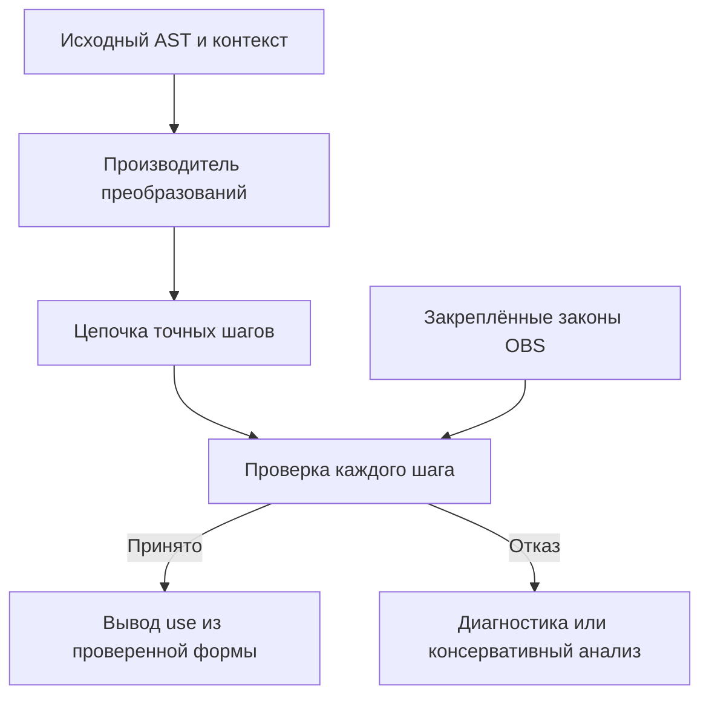

# LNK-0.3 · Проверяемые законы уточнения зависимостей

**DRAFT · R03 · 22 октября 2026.** Эта глава развивает OBS-0.1 из [главы 05](05-executable-profile.md). Владельцы интеграции: T03/T04/T05/T08/T09. Исследовательский API и его точные поля находятся в [API.md](../../models/r07-core/experiments/law-profile/API.md). Глава не меняет компактную foundation и не объявляет весь V1 реализованным.

## 1. Результат и область

Механизм получает более точный use через проверенные преобразования аналитической копии AST. Исполняемая программа и её исходная ревизия сохраняются. Каждое исключение должно иметь воспроизводимое основание, связанное с исходными входами и определёнными законами.

Входы: корректный закрытый AST OBS, точная compile-config, идентичность потребителя, привязка поставщика, revisions требований, определения семантики, каталога и проверяющего ядра. Результаты: исходный use, проверенная аналитическая форма, цепочка преобразований, уточнённый use и решение о применимости. Неподдержанный профиль, неполнота или негодное основание запрещают узкое исключение.

Два применения разделены:

- Уточнить зависимости одной неизменной программы при изменении состояния ресурса.
- Отдельным API обосновать ограниченную правку кода через общую проверенную форму двух программ.

Обычный анализ изменения кода остаётся консервативным. Второе применение обязано явно предъявить дополнительное основание. Ни одно из них не принимает программу, не выдаёт capability и не подтверждает истинность требования.

## 2. Каталог LAW-OBS-1

В фиксированном OBS-профиле разрешены только точные структурные совпадения:

| Закон | Левая часть | Правая часть | Существенная предпосылка |
| --- | --- | --- | --- |
| Размер последовательности | `size(read ordered_members)` | `read count` | Count определён длиной той же последовательности; одинаковый исход чтения |
| Множество последовательности | `to_set(read ordered_members)` | `read member_set` | Set определён теми же ID; одинаковый исход чтения |
| Размер множества | `size(read member_set)` | `read count` | ID уникальны, поэтому мощность множества равна длине последовательности |
| Повторное множество | `to_set(read member_set)` | `read member_set` | Значение уже множество; to_set идемпотентен на этом типе |

Идентификаторы записей конкретной реализации перечислены в API. Таблица описывает смысл правил, а не допускает произвольное сопоставление по сходству текста.

Сохранение ошибки проверяется по определениям: при недоступности ресурса обе стороны завершаются одним кодом; внешняя операция не выполняется после неуспешного аргумента. При успехе равенство следует из определения наблюдения и, где нужно, уникальности. Эти чтения не производят собственного emit и не меняют ресурс.

Поставщик — закреплённая встроенная семантика OBS. Совпадение строки provider_revision или пользовательский флаг полноты не подтверждают закон для нового провайдера. Законы нельзя переносить на произвольное сетевое чтение, источник с побочными эффектами, два разных снимка или список с повторениями.

Наблюдаются значение, ошибка и упорядоченная трасса. Время, объём памяти, число внутренних шагов и host-ресурсные отказы не входят в эквивалентность OBS. Если такие свойства становятся требованиями V1, их добавление в модель наблюдений открывает пересмотр этих законов.

## 3. Запись основания

Основание должно содержать следующие сведения либо позволять однозначно вычислить их из закреплённых полей; конкретная сериализация задаётся API:

| Группа | Обязательное содержание |
| --- | --- |
| Исходная привязка | ID потребителя, точный исходный AST/hash, вся compile-config, provider и revisions требований |
| Семантическая привязка | Определение OBS, hash исполняемой основы, revision каталога, правила observation equality и версия checker |
| Шаг | ID закона, путь к AST-узлу в текущем промежуточном дереве, исходный фрагмент и разрешённый результат |
| Выход | Проверенная аналитическая форма, её hash, число шагов и статус полноты анализа |
| Область | Только допустимые ресурсы и выбранные наблюдения данного профиля |

Нормализованный hash не является EntityId и не заменяет исходную ревизию. Две разные программы могут получить одинаковую аналитическую форму. Их происхождение, разрешённая область правки и требования остаются разными записями.

Подпись или хеш присланной цепочки не заменяет её replay. Проверяющее ядро само определяет допустимость каждой правой части и получает use из проверенного AST. Поле `declared_use` не является доверенным входом.

## 4. Производитель и проверка



Производитель обходит детей прежде родителя. После преобразования `to_set(read ordered_members)` родитель `size` может совпасть со следующим правилом. Все правила уменьшают число узлов; обратных правил в каталоге нет. Это даёт меру завершения, не зависящую от успешности примеров.

Проверка выполняет следующий алгоритм:

```text
check_derivation(original, context, supplied_derivation):
    validate and deeply freeze original/context
    typecheck the whole original program
    check supported semantics, provider, catalog and checker binding
    check exact original/context binding of supplied_derivation
    current = original
    for step in supplied_derivation.steps:
        enforce step/path/input limits
        locate a real AST-child node in current
        match the exact left side of the named supported law
        compute the permitted right side inside the checker
        reject any mismatch with supplied before/after
        replace only this subtree; preserve surrounding AST
        retain required type/preservation checks
    compare current with the supplied result
    infer ordinary conservative use from current
    return checked analysis with its original binding
```

Путь трактуется как структурный адрес, а не исполняемое выражение. Он относится к дереву после предыдущего шага. Индексы и поля должны иметь допустимые типы; неизвестный закон, чужое поле, неверная цель, устаревшая версия или неправильная замена дают определённый отказ.

Ненасыщенная, но корректная цепочка может быть безопасным основанием: она просто даёт менее точное описание. Нельзя называть её полной нормальной формой без отдельной проверки насыщенности. Для дальнейшего достаточного вывода важна корректность каждого шага, а не максимальное число применённых законов.

## 5. Контекстная подстановка

Каждая разрешённая пара имеет один тип, одно значение либо ошибку и одну трассу при каждом допустимом состоянии. В определённой строгой композиционной семантике замена такого подвыражения сохраняет наблюдаемое исполнение окружающей программы.

Это не разрешает перемещать чтение через emit, удалять строгий initializer, менять порядок детей, убирать условие if или непроверенную ветвь. Например, `seq(emit(...), read ordered_members)` не совпадает с `read ordered_members`. Нормализация одного законного подвыражения внутри seq оставляет эффект на месте.

Обе ветви проходят исходную проверку типов. Opaque/unknown, оставшийся где-либо в консервативном use, сохраняет неполноту даже при фактически невыбранной ветви. Две неполные трассы не являются основанием полного семантического исключения.

## 6. Применение уточнённого use

Для исходной программы P, проверенной формы N и двух состояний s/t:

```text
checked law derivation establishes P ≈ N in fixed OBS
ordinary infer_use(N) is complete
all observations required by infer_use(N) are equal on s and t
original program and all required context bindings are unchanged
    ⇒
full observed execution of P is preserved on s and t
```

Это перенос достаточного описания через эквивалентность. Ошибка прежнего запуска может сохраниться: EXCLUDED не означает успешности или satisfaction. Изменение требований продолжает создавать отдельные открытые обязательства.

При ошибочном внешнем основании обычный API должен вернуть явный отказ либо использовать исходный консервативный анализ. Он не должен молча принять supplied narrow use. Неподдержанный provider не расширяет каталог; применимость правил остаётся недоказанной.

## 7. Ограниченная правка кода

Отдельный API получает две версии одной сущности. Обе программы проходят typecheck и независимый replay. Compile-config, семантика, привязка поставщика и остальные обязательные предпосылки должны совпадать.

```text
P_old ≈ N_old        P_new ≈ N_new
N_old is structurally equal to N_new
both conservative uses are complete
    ⇒
EQUIVALENT_IN_PROFILE for the selected observations
```

`EQUIVALENT_IN_PROFILE` здесь обозначает смысл вывода; успешный статус исследовательского API называется `PROVED`. Достаточность следует по транзитивности равенства поведения. Конфлюэнтность всего каталога не требуется; различие форм возвращает `UNPROVED`. Оно не доказывает различие программ.

Для одновременного изменения кода и данных проверяются нужные наблюдения общего представления на обоих состояниях ресурса. Только тогда допустимо семантическое EXCLUDED для данного перехода. Само изменение исходника остаётся записанным и подлежит обычным правилам разрешения и приёмки. Новое/изменённое/удалённое требование не наследует истинность из эквивалентности.

## 8. Пределы и проверка

Алгоритм обязан иметь явные пределы AST, глубины путей и числа шагов. При исчерпании лимита требуется определённая диагностика или сохранённый консервативный исход. Незавершённая цепочка не должна превращаться в заявление, что все полезные правила уже рассмотрены. Фактические лимиты исследовательской реализации указаны в API.

R03 сравнивает исходный и уточнённый анализ на одном корпусе R02, отдельно добавляя случаи новых правил. Для каждого разрешённого исключения независимый oracle сравнивает исходное исполнение; для законов — также исходную и преобразованную программы. Проверяются подделанные и устаревшие основания и реально различающие мутации.

Отчёт R03 (`r07:results/law-profile/report.json`) должен фиксировать хеши всей исполнимой основы, область перебора, новые исключения, оставшиеся консервативные пересмотры, unknown и ложные исключения. Уменьшение RECHECK не является измерением ускорения: анализ и replay сами имеют стоимость.

Аргумент законов, replay и конечный эксперимент — разные основания. Здесь нет machine-checked universal proof, полного IR V1, межпроцедурного переноса, alias-анализа, рекурсии или интеграции с публикацией графа. Следующий предмет R04 — композиция summaries нескольких потребителей с сохранением предпосылок и неполноты на границах вызовов.
